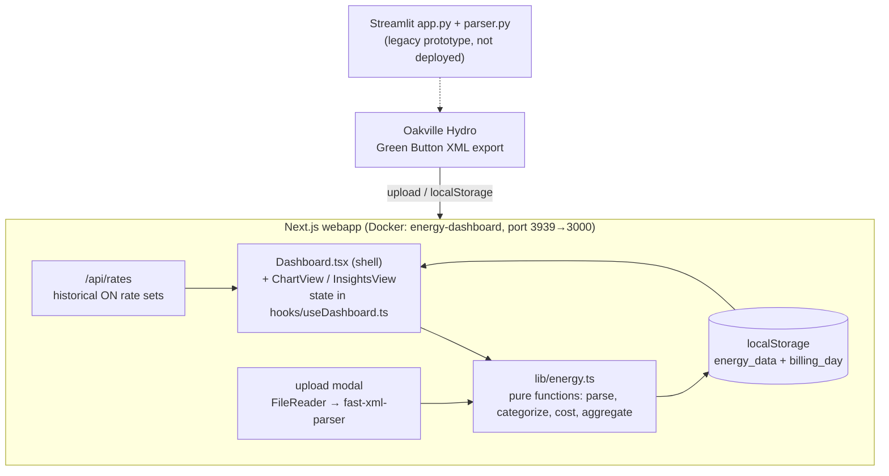

# Electricity Dashboard — Architecture

One repo, two generations of the same product idea: a **Streamlit prototype**
(the original desktop experiment, kept for reference) and the **Next.js
webapp** that superseded it and is what actually runs in Docker. Data comes
from an **Oakville Hydro Green Button XML export** (`espi`/Atom feed of hourly
interval electricity readings), analyzed against real Ontario rate plans.

## Two parallel implementations, on purpose

| | Legacy Streamlit | Current Next.js webapp |
| --- | --- | --- |
| Files | `app.py`, `parser.py` (repo root) | `webapp/src/**` |
| XML parsing | Python `xml.etree`, namespace-aware findall | `fast-xml-parser` with a manual object-stack walk (`parseGreenButtonXML`) |
| TOU classification | `classify_tou` in app.py | `categorizeTOU` in energy.ts (same Ontario winter/summer windows) |
| Rates | 3 numbers typed in the sidebar (approximate) | Versioned `RateSet` history served by `/api/rates`, matched to each reading's date |
| Plans compared | TOU only | **TOU vs Tiered vs ULO** (Ultra-Low Overnight) side by side |
| Deployment | none (local `streamlit run`) | `docker compose up` → port **3939** |

The Streamlit tree stays in the repo as the analysis prototype; the webapp is
the standard. New features go in `webapp/`. If Streamlit is ever dropped, the
root `parser.py` tests (`tests/`) are its only reason to remain.

## The webapp pipeline (all client-side, no database)

There is deliberately **no backend storage**: an upload is parsed entirely in
the browser and cached in `localStorage` (`energy_data`) — it never leaves the
user's machine. The one server route, `/api/rates`, is a static JSON snapshot
of Ontario rate history from the OEB (effective 2023-11-01 / 2024-11-01 /
2025-11-01), so rate math is versioned and reproducible rather than hardcoded
into components.

1. **Parse** — `parseGreenButtonXML` walks the feed object stack, pulls every
   `IntervalReading` (`timePeriod.start` unix seconds + `value` in Wh → kWh).
2. **Rates** — `processRawData` sorts `RateSet`s newest-first and, per reading,
   attaches the set active on `yyyy-MM-dd` (falls back to the oldest set).
3. **Categorize** — per interval: `categorizeTOU` (weekend/hour windows,
   winter Nov–Apr vs summer May–Oct — identical windows to the OEB schedule)
   and `categorizeULO` (12 nights a day Overnight, weekend off-peak, 4–9 pm
   on-peak). Costs computed for **all three plans simultaneously** per reading:
   `costTOU`, `costULO`, and `costTiered` (tier thresholds prorated
   `(days/30.4)` per aggregation bucket).
4. **View filter** — scope = Billing period (anchored to a persisted
   `billing_day`, `getBillingPeriod`), Month, YTD, or custom range; zoom
   monthly → weekly → daily → hourly (`getFilteredForZoom`). First load picks
   the window with `selectInitialWindow`: anchor `min(last data day, today)`,
   then the first of billing period → calendar month → trailing data-anchored
   window that is at least half covered by readings, so a fresh upload never
   opens a mostly-future window.
5. **Aggregate & analyze** — `aggregateChartData` per bucket, plus
   `calculateComparison` (totals across the three plans),
   `calculateVampire` (5th-percentile hourly draw × 24h × 30d at off-peak —
   the "always-on" base-load estimate), `detectAnomalies` (per-weekday
   expected average; a spike is >1.5× expected AND >5 kWh, top 5 reported),
   `buildHeatmapData` (7×24 weekday/hour average grid),
   `calculateFullDataTotals` (whole-dataset kWh + per-plan cost + best-vs-worst
   dollar delta behind the "since {first date}" strip — deliberately not
   filtered by the visible window).
6. **Render** — `ChartView.tsx` / `InsightsView.tsx` (Recharts) inside the
   `Dashboard.tsx` shell, with a neobrutalist design language (thick black
   borders, hard offset shadows, yellow-400 highlights); weekend daily bars
   are highlighted orange (`getBarColor`).

7. **Recommend** — `analyzeTouShifts` (`lib/touShift.ts`) ranks recurring
   ToU-shift blocks over the loaded history: On-Peak as the primary tier and
   TOU Mid-Peak as a lower tier, every block priced against a rate the user
   actually pays. The user-facing layer on top of those numbers is pure too:
   `classifyBlock` (fixed-schedule / HVAC-like / honest "unidentified"),
   `confidenceBadge` (Very consistent / Somewhat / Irregular),
   `collapseHeadline` (one headline when a single destination owns >50% of the
   savings, blocks demoted to supporting rows) and a per-option `effort`
   (plan switch required or not). `ShiftOptimizer.tsx` only renders verdicts.

All pure math lives in `lib/energy.ts` and `lib/touShift.ts`, unit-tested in
`energy.test.ts` / `touShift.test.ts` / `ShiftOptimizer.test.tsx`. State and
effects live in `hooks/useDashboard.ts`;
`Dashboard.tsx`/`ChartView.tsx`/`InsightsView.tsx` are markup wired to it
(`Dashboard.test.tsx`). Keep the boundary: adding an analytic means a pure
function + test first, then wiring.

## Ops

- **Run:** `docker compose up -d` from the repo root; open
  `http://localhost:3939`. Restart policy `always`.
- **Build:** multi-stage Node 20 Alpine, `npm run build` → Next.js
  `standalone` output, non-root user. No secrets, no volumes, no env vars.
- **Data safety:** everything user-related is browser-local. A container
  rebuild loses nothing; clearing browser storage is the only way to lose data.
- **CI** (`.github/workflows/ci.yml`, push/PR to main): two jobs —
  `webapp`: lint → typecheck → vitest → build; root: pytest for parser tests.
  A change to either layer runs the full gate for that layer.
