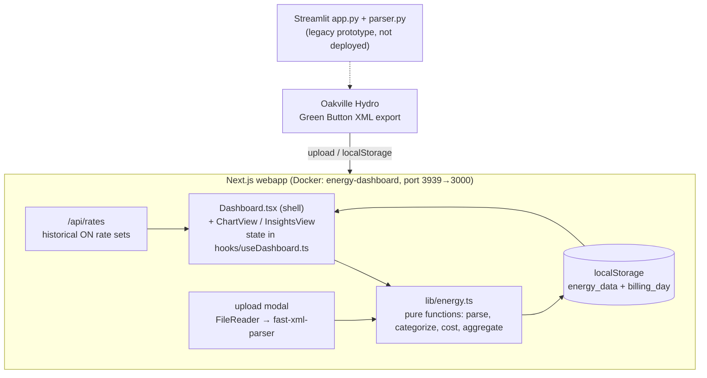

# Electricity Dashboard — Architecture

One repo, two generations of the same product idea: a **Streamlit prototype**
(the original desktop experiment, kept for reference) and the **Next.js
webapp** that superseded it and is what actually runs in Docker. Data comes
from an **Oakville Hydro Green Button XML export** (`espi`/Atom feed of hourly
interval electricity readings), analyzed against real Ontario rate plans.

## Two parallel implementations, on purpose

| | Legacy Streamlit | Current Next.js webapp |
| --- | --- | --- |
| Files | `app.py`, `parser.py` (repo root) | `webapp/src/**` |
| XML parsing | Python `xml.etree`, namespace-aware findall | `fast-xml-parser` with a manual object-stack walk (`parseGreenButtonXML`) |
| TOU classification | `classify_tou` in app.py | `categorizeTOU` in energy.ts (same Ontario winter/summer windows) |
| Rates | 3 numbers typed in the sidebar (approximate) | Versioned `RateSet` history served by `/api/rates`, matched to each reading's date |
| Plans compared | TOU only | **TOU vs Tiered vs ULO** (Ultra-Low Overnight) side by side |
| Deployment | none (local `streamlit run`) | `docker compose up` → port **3939** |

The Streamlit tree stays in the repo as the analysis prototype; the webapp is
the standard. New features go in `webapp/`. If Streamlit is ever dropped, the
root `parser.py` tests (`tests/`) are its only reason to remain.

## The webapp pipeline (all client-side, no database)

There is deliberately **no backend storage**: an upload is parsed entirely in
the browser and cached in `localStorage` (`energy_data`) — it never leaves the
user's machine. Accounts are the one thing that would change this, and they
exist on neither this branch nor this deployment: the account server is built
but unmerged and parked — see
[ACCOUNT-SERVER-AUDIT.md](ACCOUNT-SERVER-AUDIT.md). The one server route,
`/api/rates`, is a static JSON snapshot
of Ontario rate history from the OEB (effective 2023-11-01 / 2024-11-01 /
2025-11-01), so rate math is versioned and reproducible rather than hardcoded
into components.

1. **Parse** — `parseGreenButtonXML` walks the feed object stack, pulls every
   `IntervalReading` (`timePeriod.start` unix seconds + `value` in Wh → kWh).
   The same function serves two doors: a real file from the upload input, and
   the bundled example set (`public/samples/example-usage.xml`, fetched by
   `lib/exampleData.ts` on **Try with example data**) — there is deliberately
   no second parse path to keep working.
2. **Rates** — `processRawData` sorts `RateSet`s newest-first and, per reading,
   attaches the set active on `yyyy-MM-dd` (falls back to the oldest set).
3. **Categorize** — per interval: `categorizeTOU` (weekend/hour windows,
   winter Nov–Apr vs summer May–Oct — identical windows to the OEB schedule)
   and `categorizeULO` (12 nights a day Overnight, weekend off-peak, 4–9 pm
   on-peak). Costs computed for **all three plans simultaneously** per reading:
   `costTOU`, `costULO`, and `costTiered` (tier thresholds prorated
   `(days/30.4)` per aggregation bucket).
4. **View filter** — scope = Billing period, Month, YTD, or custom range;
   zoom monthly → weekly → daily → hourly (`getFilteredForZoom`). The
   BillingPeriod scope runs off **`lib/billingAxis.ts`**: the file's OWN
   `UsageSummary.billingPeriod` entries (de-duped when two exports describe
   the same bill, holes between them kept as explicit `gap` periods, the
   readings past the last bill as one `open` period). Prev/next step those
   periods one at a time and stop at the ends; `billing_day` +
   `getBillingPeriod` is the fallback for a file that states no periods, and
   first load opens the axis period holding `min(last data day, today)` under
   the same ≥50%-coverage gate `selectInitialWindow` applies (falling back to
   it: billing period → calendar month → trailing data-anchored window), so a
   fresh upload never opens a mostly-future window.
5. **Aggregate & analyze** — `aggregateChartData` per bucket, plus
   `calculateComparison` (totals across the three plans),
   `calculateVampire` (5th-percentile hourly draw × 24h × 30d at off-peak —
   the "always-on" base-load estimate), `detectAnomalies` (per-weekday
   expected average; a spike is >1.5× expected AND >5 kWh, top 5 reported),
   `buildHeatmapData` (7×24 weekday/hour average grid),
   `calculateFullDataTotals` (whole-dataset kWh + per-plan cost + best-vs-worst
   dollar delta behind the "since {first date}" strip — deliberately not
   filtered by the visible window).
6. **Render** — `ChartView.tsx` / `InsightsView.tsx` (Recharts) inside the
   `Dashboard.tsx` shell, with a neobrutalist design language (thick black
   borders, hard offset shadows, yellow-400 highlights); weekend daily bars
   are highlighted orange (`getBarColor`).

7. **Recommend** — `analyzeTouShifts` (`lib/touShift.ts`) ranks recurring
   ToU-shift blocks over the loaded history: On-Peak as the primary tier and
   TOU Mid-Peak as a lower tier, every block priced against a rate the user
   actually pays. The user-facing layer on top of those numbers is pure too:
   `classifyBlock` (fixed-schedule / HVAC-like / honest "unidentified"),
   `confidenceBadge` (Very consistent / Somewhat / Irregular),
   `collapseHeadline` (one headline when a single destination owns >50% of the
   savings, blocks demoted to supporting rows) and a per-option `effort`
   (plan switch required or not). `ShiftOptimizer.tsx` only renders verdicts.

### What this browser persists

Everything below is `localStorage`, cleared only by the Reset button
(`emergencyReset` → `localStorage.clear()`), and all of it is written by a
browser-local app that never uploads any of it:

| Key | Written by | Read by |
| --- | --- | --- |
| `energy_data` | upload / sample button / backup restore | `useEnergyData` start sequence |
| `energy_data_is_example` | the sample button (`commitReadings(source)`), cleared by a real upload | the "example data — not real usage" banner |
| `billing_day` | `updateBillingDay` | `getBillingPeriod` anchors |
| `selected_plan` | `useSelectedPlan` (nav switcher, plan cards) | `useSelectedPlan` — the switcher AND the header chip read one store |
| `extra_charges` | True-bill fields | `useExtraCharges` |
| `open_estimate_ledger` | `useEstimateLedger` (the open period's claim + every claim a bill has since scored) | `lib/estimateLedger` — settles on load, so a new export closes its own windows |

## Accessibility (standing gate)

Wave H made this a checklist instead of a one-shot pass. Every rule below has
a test that fails if it regresses — `src/components/WaveH.test.tsx` for DOM
behaviour, `tests/e2e/journey.spec.ts` for anything that needs real CSS
cascade or real event dispatch (focus rings, `@media print`, crash dispatch).

**1. Focus is always visible.** One rule in `globals.css`: a white edge plus a
blue halo (`:focus-visible`), chosen because the design language has white,
yellow *and* black chips and a single-colour outline always loses on one of
them. Any interactive element must be Tab-reachable and must show that ring;
a `div` with `onClick` must carry `role="button"`, `tabIndex={0}` and an
Enter/Space handler (the plan cards are the worked example).

**2. Escape closes the top overlay.** The listener lives in `Dashboard.tsx`
and walks the stack top-down: always-on floor help → UsagePoint picker →
merge review → upload modal. The backup drawer owns its own (it also has to
keep `aria-expanded` honest). The upload modal is *not* dismissable while the
parser is running. **Adding an overlay without adding it here is a bug** —
covered by the four Escape tests.

**3. Every control has a name and a state.** Icon-only buttons get
`aria-label` (never `title` alone), toggle groups get `aria-pressed`, dialogs
get `role="dialog"` + `aria-modal` + an accessible name, and the heatmap is a
`role="grid"` of `gridcell`s whose `aria-label`/`title` repeat what the hover
tooltip shows (hover-only information is not accessible information).

**4. The chart never looks broken.** Empty window → an explicit
"no readings in this window" panel instead of a bare axis; data *arriving* →
the `ChartSkeleton` shimmer for the ~500 ms Recharts grow-in (keyed on the
0 → N rows transition, so it never flashes on a zoom or tab switch), with
`prefers-reduced-motion` honoured.

**5. Print is a supported output.** `.no-print` on every piece of chrome
(nav bar, zoom controls, export buttons), `.print-compact` on the printable
view (`InsightsView`) for tighter type and a compressed heatmap,
`@page { size: portrait }` with `print-color-adjust: exact` so the
neobrutalist palette survives onto paper, and `break-inside: avoid` on cards.
Verified by the journey spec's print test (Letter-width viewport, print media
emulation, screenshot in `evidence/`).

**6. Nothing fails silently.** `AppErrorBoundary` (mounted in `layout.tsx`)
turns both React render errors and uncaught runtime errors — the ones event
handlers throw, which React boundaries never see — into one screen with a
copyable `ERR-…` id, "your readings were not touched", and a reset that
re-mounts the tree.

**7. Phone-first, and the phone numbers are checked.** Wave I made 390x844 and
360x800 first-class viewports instead of a desktop layout squeezed narrow. The
standing numbers: **no horizontal page scroll** (`documentElement.scrollWidth`
must equal `clientWidth`) except where a wide grid scrolls *inside* its own
`overflow-x:auto` card; **every hit box ≥ 44x44 CSS px** (a radio/checkbox
scores on its wrapping `<label>`, because that is the region a tap activates);
**every form field ≥ 16px** on phones (iOS auto-zooms the page below that);
**an overlay is dismissible two ways** — Escape *and* a tap (Cancel, Close, or
tap-outside for the backup drawer, which has no backdrop); and **every
`:hover` affordance has an `:active` twin**, because touch never hovers.
Fixed overlays use `.overlay-safe` rather than `p-4`, so `env(safe-area-inset-*)`
clears the status bar and home indicator once `viewport-fit: cover` is on.
All of it is re-runnable in one command —
`node scripts/mobile-audit.cjs <baseURL> <outdir>` — and CI asserts the
outcome two ways: the mobile Lighthouse budget (≥0.85, CLS ≤0.1) and the
Playwright suite.

## Accessibility quick checklist for new UI

- [ ] Tab reaches it, and the focus ring is visible on it (any background).
- [ ] It has an accessible name (icon-only → `aria-label`; toggle → `aria-pressed`).
- [ ] If it opens an overlay: `role="dialog"` + `aria-modal` + Escape closes it.
- [ ] If it conveys data, the information exists as text, not only on hover.
- [ ] It is either printable or explicitly `.no-print`.
- [ ] At 360px: hit box ≥ 44px, no horizontal page scroll, and a form field is ≥ 16px.
- [ ] If it has a `:hover` effect it also has `:active`, and if it is an
      overlay Escape *and* a tap both close it.
- [ ] It is asserted in `WaveH.test.tsx` (or the journey spec if it needs real CSS).

All pure math lives in `lib/energy.ts` and `lib/touShift.ts`, unit-tested in
`energy.test.ts` / `touShift.test.ts` / `ShiftOptimizer.test.tsx`. State and
effects live in `hooks/useDashboard.ts`;
`Dashboard.tsx`/`ChartView.tsx`/`InsightsView.tsx` are markup wired to it
(`Dashboard.test.tsx`). Keep the boundary: adding an analytic means a pure
function + test first, then wiring.

## Ops

- **Run:** `docker compose up -d` from the repo root; open
  `http://localhost:3939`. Restart policy `always`.
- **Build:** multi-stage Node 20 Alpine, `npm run build` → Next.js
  `standalone` output, non-root user. No secrets, no volumes, no env vars.
- **Data safety:** everything user-related is browser-local. A container
  rebuild loses nothing; clearing browser storage is the only way to lose data.
- **CI** (`.github/workflows/ci.yml`, push/PR to main): three jobs —
  `frontend`: lint → typecheck → vitest → build; `smoke`: build the real
  Docker image, boot it, HTTP checks, Playwright (Wave D smoke + Wave H
  full journey, `tests/e2e/*.spec.ts`) and **two Lighthouse performance
  budgets** — desktop ≥ 90 (`lighthouserc.json`) and mobile ≥ 85 with CLS ≤ 0.1
  (`lighthouserc.mobile.json`, 390x844 @3x under Lighthouse's mobile
  throttling); `python`:
  pytest for parser tests. A change to either layer runs the full gate for
  that layer.
- **Dependencies**: `.github/dependabot.yml` opens weekly PRs for npm
  (`/webapp`), the Docker base image and GitHub Actions, each auto-assigned
  to a reviewer. **Auto-merge is off on purpose** — rate-library bumps in
  particular stay behind the human gate recorded in DECISIONS.md.
- **Sample data**: `public/samples/example-usage.xml` is generated by
  `webapp/scripts/generate-example-fixture.mjs` (seed-deterministic). The
  root `.gitignore` ignores `*.xml` to keep real meter exports out of the
  repo; the sample has its own narrow `!webapp/public/samples/*.xml`
  exception, exactly like `webapp/tests/fixtures/`. Never widen it further.
